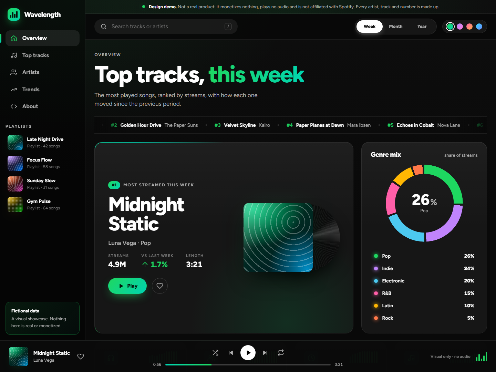

# Wavelength · Top Tracks Dashboard

A dark, animated music top-charts dashboard built with **Next.js (App Router), TypeScript and a lot of hand-written CSS**.

> **This is a design showcase, not a product.** It monetizes nothing, plays no audio and is not affiliated with Spotify or any streaming company. It only borrows the dark-and-green look everybody knows. Every artist, track, cover and number is fictional.



## What it shows

- **Hero** with the number one track: floating sleeve, a vinyl that spins while it "plays", 3D tilt on hover and a rotating gradient border.
- **Top 10 list** that reorders with **View Transitions** when you switch Week / Month / Year, with popularity bars, movement arrows, `NEW` badges and live search (press `/`).
- **KPI cards** with count-up numbers animated by CSS alone.
- **Genre donut** made of stacked conic gradients; hover a legend row and the other slices dim (pure CSS, `:has()`).
- **Top artists**, a **listening heatmap** and a **streams chart** with a dock-like hover effect.
- **Player bar** (visual only) with a custom range slider, shuffle, repeat and a working queue.
- **Accent switcher**: the whole theme cross-fades between four palettes.
- Fully responsive: the sidebar becomes a bottom tab bar and the player a mini player on phones.

## CSS is the star

| Technique | Where |
| --- | --- |
| Cascade layers (`@layer reset, tokens, base, layout, components, motion`) | `src/styles/layers.css` |
| Typed custom properties (`@property`) for animated gradients, counters and the accent | `src/styles/properties.css` |
| Container queries (track list and donut adapt to their card, not the viewport) | `tracks.css`, `charts.css` |
| `:has()` for the segmented control, like button and chart hover states | `controls.css`, `charts.css` |
| View Transitions for list reordering | `motion.css`, `src/lib/viewTransition.ts` |
| Scroll-driven reveals (`animation-timeline: view()`) | `motion.css` |
| CSS counters + typed integers for count-up numbers | `kpi.css` |
| Generated cover art with `oklch()`, gradients and blend modes (no images) | `cover.css` |
| `color-mix()`, masks, `backdrop-filter`, `linear()` spring easing | across the board |
| `prefers-reduced-motion` support | `motion.css` |

React and TypeScript handle state, the player, search and data; the visual work lives in the stylesheets.

## SEO and performance

- Statically generated: the whole dashboard is in the initial HTML, so crawlers and link previews see real content.
- Metadata API: title template, description, keywords, canonical URL, Open Graph, Twitter cards and robots directives.
- Generated social preview image (`opengraph-image.tsx`), `sitemap.xml`, `robots.txt` and a web app manifest.
- JSON-LD structured data (`WebSite`, `WebApplication`, `SoftwareSourceCode`, `Person`).
- One `h1`, a proper heading outline, landmarks, a skip link, labelled controls and `aria` on the charts.
- Fonts self-hosted through `next/font` (no layout shift), one variable font file, zero images, zero UI dependencies.
- Server Components for static parts (playlists, about, footer) passed as slots into the client dashboard.

### Performance budget

The first version looked heavy and felt it, so the visual effects follow a budget now:

- No `backdrop-filter`, `mix-blend-mode`, blurred blobs or full-screen overlays; the background is two static gradients that scroll with the page.
- Entrances animate `transform`, `opacity` and typed properties only. Nothing animates a filter.
- Looping animations run only while they are useful: the marquee, the equalizer and the vinyl (while "playing") and the hero border (while hovered).
- View Transitions name the rows only while a transition is running.
- Compact data sent to the client (one ranked list per period, the heatmap as a plain array of numbers).

On the same machine, an idle page went from about 270 ms to about 30 ms of main-thread work per 5 seconds, and scrolling went from roughly 27 to 60 fps in a software-rendered headless browser.

## Run it

```bash
npm install
npm run dev
```

```bash
npm run build && npm start
```

Optional: copy `.env.example` to `.env.local` and set `NEXT_PUBLIC_SITE_URL` so canonical URLs, Open Graph and the sitemap use your domain. On Vercel the production domain is picked up automatically.

## Structure

```
src/
  app/          layout, page, metadata routes (OG image, sitemap, robots, manifest)
  components/   dashboard UI (client) and static sections (server)
  data/         fictional catalogue and the seeded generators for each period
  hooks/        player queue, scroll spy, pointer spotlight
  lib/          formatting, seeded RNG, site config, view-transition helper
  styles/       layered CSS: tokens, base, layout, components, motion
```

## Notes

- The data is generated from a seeded random number generator, so server and client always agree and charts are stable between reloads.
- Browser support: modern evergreen browsers. Features without support (View Transitions, scroll-driven animations) degrade to plain updates.

Built by [Ivan Caggiano](https://porfolio-ivan-caggiano.vercel.app/).
